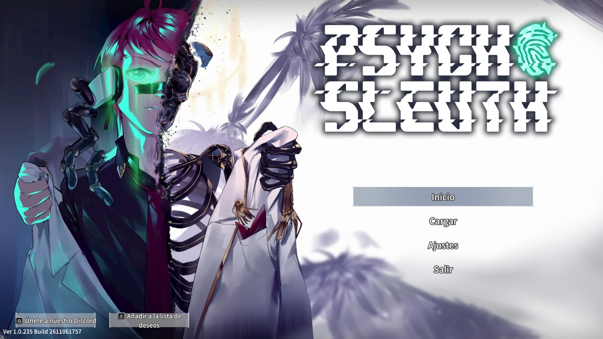
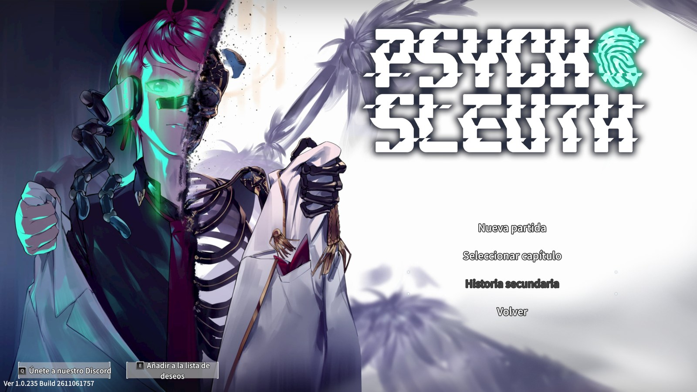
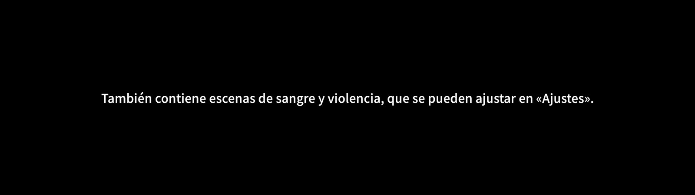

# Psycho-Sleuth — Parche en Español

Parche de traducción al español (fan) para **Psycho-Sleuth** (versión de Steam, Windows).

**[⬇ Descargar el instalador](../../releases/latest)**

## Capturas







## Qué traduce

- Todos los diálogos de la historia
- Menús e interfaz
- Subtítulos de los vídeos

## Instalación

1. Descarga **`Instalar_Parche_Espanol.exe`** desde la sección [Releases](../../releases/latest).
2. Cierra el juego si está abierto.
3. Ejecuta `Instalar_Parche_Espanol.exe`.
   - Encuentra el juego automáticamente en tus bibliotecas de Steam.
   - Si no lo encuentra, te pedirá la carpeta del juego. En Steam: clic derecho en *Psycho-Sleuth* > *Administrar* > *Ver archivos locales*, copia esa ruta y pégala.
   - Otra opción: copia el `.exe` dentro de la carpeta del juego y ejecútalo ahí.
4. Elige la opción **1) Instalar** y espera unos segundos.
5. Abre el juego y, en las opciones, selecciona el idioma **English**. El texto se mostrará en español.

> Windows SmartScreen puede avisar porque el `.exe` no está firmado. Pulsa *Más información* > *Ejecutar de todas formas*.

## Desinstalación

Ejecuta de nuevo `Instalar_Parche_Espanol.exe` y elige **2) Desinstalar**. Así se restauran los archivos originales desde la copia de seguridad (`_respaldo_parche_es`, en la carpeta del juego).

También puedes usar Steam > clic derecho en el juego > *Propiedades* > *Archivos instalados* > *Verificar integridad de los archivos del juego*.

## Si el juego se actualiza

Una actualización de Steam puede devolver los archivos al inglés. Vuelve a ejecutar el instalador y elige **1**. Si una actualización de Steam reemplaza los archivos, antes de reinstalar elimina la carpeta `_respaldo_parche_es`, para que la copia de seguridad se haga con la versión nueva.

## Notas

- Los nombres de personajes, habilidades, títulos, lugares y grupos se mantienen en inglés, como en el original.
- El repositorio no incluye archivos del juego. El instalador modifica tu propia copia, así que necesitas tener el juego comprado.
- Este parche no es oficial ni está afiliado a los desarrolladores.

## Ejecutar desde el código (opcional)

```
pip install UnityPy==1.25.4
python parche.py "D:\SteamLibrary\steamapps\common\Psycho-Sleuth"
```
